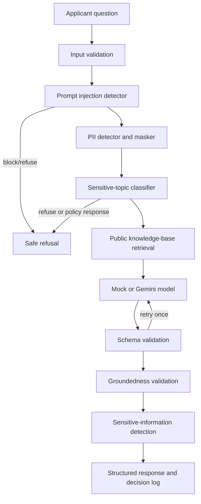

# Architecture

The system is a deterministic retrieval-augmented FAQ assistant with ordered
input and output guardrails:



The same flow in plain text:

```text
Applicant question
        |
        v
Input validation and length limit
        |
        v
Prompt-injection detector  -- block/refuse
        |
        v
PII detector and masker     -- mask and continue
        |
        v
Sensitive-topic classifier  -- refuse, disclaimer, or pointer
        |
        v
Public knowledge-base retrieval
        |
        v
Model provider (mock or Gemini)
        |
        v
Schema validation           -- retry once
        |
        v
Groundedness validation     -- remove unsupported claims/fallback
        |
        v
Output leakage detection    -- redact or fallback
        |
        v
Structured final response and decision log
```

## Modules

| Area | Module |
|---|---|
| Runtime settings | [`src/settings.py`](../src/settings.py) |
| Input orchestration | [`src/input_pipeline.py`](../src/input_pipeline.py) |
| Injection detection | [`src/input_injection.py`](../src/input_injection.py) |
| PII masking | [`src/pii_guardrail.py`](../src/pii_guardrail.py) |
| Topic policy | [`src/sensitive_topics.py`](../src/sensitive_topics.py) |
| Retrieval | [`src/knowledge_base.py`](../src/knowledge_base.py) |
| Model contract/providers | [`src/model.py`](../src/model.py) |
| Output orchestration | [`src/output_pipeline.py`](../src/output_pipeline.py) |
| Schema validation | [`src/output_schema.py`](../src/output_schema.py) |
| Groundedness | [`src/groundedness.py`](../src/groundedness.py) |
| Leakage detection | [`src/output_sensitive.py`](../src/output_sensitive.py) |
| End-to-end flow | [`src/orchestrator.py`](../src/orchestrator.py) |

The model provider cannot bypass the guardrails: both the mock model and Gemini
implement the same `Model.generate()` contract, and every generated response
continues through the output pipeline.
